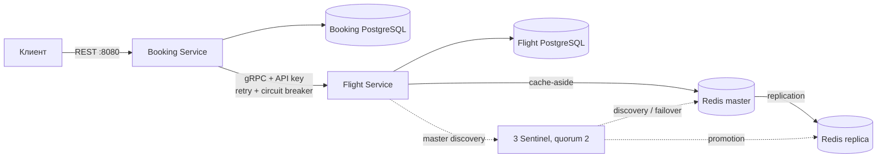

# ДЗ №3 — Flight Booking: gRPC + Redis

Стек: Python 3.12, FastAPI, gRPC/protobuf, PostgreSQL 16, Flyway, Redis 7.4 Sentinel.

## Запуск

Из каталога `sre_homework3/flight_booking`:

```bash
docker compose up --build
```

- REST и Swagger: [http://localhost:8080/docs](http://localhost:8080/docs).
- OpenAPI: [http://localhost:8080/openapi.json](http://localhost:8080/openapi.json).
- Проверка Booking Service: `GET /health`.
- Внутренний gRPC: `flight-service:50051`; БД, Redis и Sentinel наружу не публикуются.

Порт 8080 должен быть свободен. Настройки по умолчанию подходят для локального запуска; изменения задаются в `.env` по образцу `.env.example`.

```bash
docker compose --profile test run --rm tests   # автоматические проверки
docker compose logs -f booking-service flight-service
docker compose down                          # остановить, данные сохранить
```

Для полностью чистого учебного стенда `docker compose down -v` удаляет **его** данные и конфигурацию Sentinel. Следующий запуск заново применяет миграции и seed.

## Архитектура



[ER-диаграммы и обоснование 3NF](docs/ER.md). Приложения используют только свою БД. Доступ тестов к обеим БД нужен для проверки инвариантов и внесения тестовых сбоев.

## Соответствие критериям

| № | Реализация | Где смотреть |
|---|---|---|
| 1 | 4 обязательных RPC + UpdateFlight, Timestamp, enum, коды ошибок, protoc | `proto/flight.proto`, `Dockerfile` |
| 2 | 3NF, отдельные ER-диаграммы, UNIQUE/CHECK/FK | `docs/ER.md`, `migrations/` |
| 3 | Два PostgreSQL, Flyway, 6 REST-маршрутов, gRPC-сервер | `docker-compose.yml`, оба сервиса |
| 4 | GetFlight → ReserveSeats → фиксация суммы → INSERT Booking; отмена через gRPC | `booking_service/main.py` |
| 5 | Транзакции, SELECT FOR UPDATE, журнал компенсаций | `flight_service/server.py`, `operations` |
| 6 | API key в metadata всех RPC, UNAUTHENTICATED | `AuthInterceptor`, `GRPC_API_KEY` |
| 7 | Cache-aside, TTL 300–600 с, инвалидация поиска и карточки, hit/miss | `flight_service/cache.py`, `cache_revision` |
| 8 | До 3 попыток, backoff 100/200 мс, только временные ошибки; идемпотентность | `booking_service/resilience.py`, UNIQUE(booking_id) |
| 9 | Redis master + replica + 3 Sentinel, quorum=2, Sentinel-клиент | `redis/`, `docker-compose.yml` |
| 10 | Потокобезопасный клиентский gRPC interceptor с CLOSED/OPEN/HALF_OPEN | `booking_service/resilience.py` |

## Контракты и примеры

ID — UUID. `user_id` — строковый идентификатор внешнего пользователя. IATA — три заглавные латинские буквы. Даты поиска — `YYYY-MM-DD`, день определяется по UTC. Timestamp в protobuf и ISO 8601 в REST используются для времени вылета, прилёта и создания. Цена передаётся десятичной строкой в рублях, считается через Decimal и сохраняется как NUMERIC, без float.

В seed есть рейсы на **1 и 2 апреля 2030**, чтобы пример не зависел от текущего дня:

| ID | Рейс | Маршрут | Дата UTC | Места | Цена | Статус |
|---|---|---|---|---|---|---|
| `11111111-1111-4111-8111-111111111111` | SU1000 | SVO → LED | 2030-04-01 | 100 | 5500.50 | SCHEDULED |
| `22222222-2222-4222-8222-222222222222` | SU1002 | SVO → LED | 2030-04-02 | 1 | 7000.00 | SCHEDULED |
| `33333333-3333-4333-8333-333333333333` | FV2000 | VKO → LED | 2030-04-01 | 50 | 4900.00 | CANCELLED |

```bash
curl 'http://localhost:8080/flights?origin=SVO&destination=LED&date=2030-04-01'
curl 'http://localhost:8080/flights?origin=SVO&destination=LED'
curl http://localhost:8080/flights/11111111-1111-4111-8111-111111111111

curl -X POST http://localhost:8080/bookings \
  -H 'Content-Type: application/json' \
  -d '{"user_id":"student-1","flight_id":"11111111-1111-4111-8111-111111111111","passenger_name":"Иван Петров","passenger_email":"ivan@example.com","seat_count":2}'
```

Последний запрос возвращает 201, UUID бронирования, `status: CONFIRMED`, `total_price: "11001.00"`. Подставьте полученный UUID:

```bash
curl http://localhost:8080/bookings/BOOKING_UUID
curl 'http://localhost:8080/bookings?user_id=student-1'
curl -X POST http://localhost:8080/bookings/BOOKING_UUID/cancel
```

Повтор отмены безопасен: возвращает CANCELLED и не увеличивает места повторно. Повтор **HTTP POST /bookings** — новая покупка. Идемпотентность из ТЗ гарантируется для повторов gRPC ReserveSeats внутри одной операции, с одним booking_id.

| gRPC | HTTP | Ситуация |
|---|---|---|
| INVALID_ARGUMENT | 400 | Ошибочные аргументы RPC |
| NOT_FOUND | 404 | Рейс не найден |
| RESOURCE_EXHAUSTED | 409 | Недостаточно мест |
| ALREADY_EXISTS | 409 | Один booking_id с разными параметрами |
| FAILED_PRECONDITION | 409 | Рейс не SCHEDULED или резерв уже освобождён |
| UNAVAILABLE | 503 | Недоступность Flight / открытый Circuit Breaker |
| DEADLINE_EXCEEDED | 504 | Истёк deadline после повторов |
| UNAUTHENTICATED | 502 | Неверная сервисная настройка credentials |

Ошибка gRPC: `{"error_code":"...","message":"..."}`. Валидация REST возвращает стандартный FastAPI 422 с `detail`, отсутствующее бронирование — 404 с `detail`. REST-аутентификация пользователей в задании не требуется; `user_id` используется как входное поле, не как проверенная личность.

Генерация выполняется в Dockerfile. Для локальной генерации после установки `requirements.txt`: `make generate`; локальный PYTHONPATH должен включать `.` и `generated`. Сгенерированные файлы не редактируются и не хранятся в исходниках.

## Транзакции и восстановление

Flight Service берёт транзакционную advisory-блокировку по booking_id и `SELECT ... FOR UPDATE` на рейс. Проверка остатка, списание и INSERT резервации коммитятся вместе. Отмена атомарно возвращает места и меняет статус. Конкурентные резервы не могут сделать остаток отрицательным; одинаковые booking_id возвращают одну резервацию. Другой payload для занятого ключа даёт ALREADY_EXISTS.

Booking Service до ReserveSeats сохраняет техническую операцию CREATE. Затем держит блокировку этой операции, вызывает RPC, записывает Booking и помечает операцию DONE в одной локальной транзакции. При ошибке Booking не появляется, запускается ReleaseReservation. Отмена аналогично сохраняет CANCEL до удалённого вызова, затем фиксирует CANCELLED и DONE вместе.

Если процесс упал или Flight недоступен во время компенсации, фоновый обработчик подбирает PENDING старше 30 секунд. CREATE компенсируется, CANCEL завершается. `FOR UPDATE SKIP LOCKED` исключает вмешательство в живую транзакцию. ReleaseReservation для ещё неизвестного booking_id сохраняет запрет на поздний резерв — таймаут и опоздавший RPC не оставят «утёкшие» места.

Внутри каждого сервиса изменения атомарны. Между двумя БД используется saga: при сбое компенсация может отложиться до восстановления Flight Service. Незавершённые операции сохраняются в журнале и повторяются фоновым обработчиком.

## Кеш, Sentinel и Circuit Breaker

Ключи: `flight:{id}:v{revision}`, `search:{origin}:{destination}:{date|all}:v{revision}`. Чтение проверяет Redis, при miss получает данные из PostgreSQL и делает SETEX. Все кеш-ключи имеют TTL, включая пустой результат поиска. Логи содержат `cache hit`, `cache miss`, `cache invalidated`.

Мутации ReserveSeats, ReleaseReservation, UpdateFlight меняют поколение кеша **в той же транзакции**, что и данные. Read-only REPEATABLE READ гарантирует одинаковый снимок для поколения и данных. Старые ключи удаляются после коммита; если Redis недоступен или старое чтение поздно записало кеш, такие ключи уже недостижимы и исчезнут по TTL. Даже потеря Redis-записей при failover не возвращает старый остаток. Цена этой гарантии — один короткий SELECT поколения из PostgreSQL на cache hit; кеш экономит чтение самих карточек и выборок, но не делает приложение независимым от БД.

Sentinel-клиент ищет актуального master, три Sentinel выбирают нового при отказе. Конфиги Redis/Sentinel сохраняются в volumes и допускают CONFIG REWRITE. Временная недоступность кеша не останавливает сервис: используется PostgreSQL. Весь Compose работает на одном компьютере, поэтому это демонстрация отказа процесса/контейнера, а не защита от потери хоста.

Client interceptor применяет deadline к каждой попытке (2 с), до 3 попыток с задержками 100 и 200 мс. Повторяются только UNAVAILABLE и DEADLINE_EXCEEDED. Пять подряд неудачных логических вызовов за последние 60 с открывают Circuit Breaker на 15 с. Повторы одного RPC считаются одним логическим вызовом. В OPEN вызова по сети нет, REST получает 503 с сообщением. После таймаута один запрос проходит в HALF_OPEN, без повторов; другие сразу отклоняются. Ответ с бизнес-ошибкой тоже доказывает доступность Flight и сбрасывает счётчик недоступности. Поздние результаты старых конкурентных вызовов не закрывают уже открытый circuit.

Порог, таймаут и окно учёта ошибок задаются `CB_FAILURE_THRESHOLD`, `CB_RESET_SECONDS`, `CB_WINDOW_SECONDS`; deadline — `GRPC_TIMEOUT_SECONDS`. Переходы состояний пишутся в логи.

Переподключение канала ограничено backoff до 1 с, чтобы после перезапуска контейнера не ждать стандартную длинную задержку gRPC. Единственный HALF_OPEN-запрос использует wait-for-ready в пределах своего deadline, остальные запросы в этом состоянии сразу отклоняются.

## Проверки и демонстрация отказов

[Сценарии отказов и SQL-проверки](docs/TESTING.md). Автотесты проверяют REST, все RPC без/с неверным ключом, последнюю свободную позицию под 20 конкурентными запросами, повторы и конфликт idempotency key, инвалидацию и TTL, потерю ответа после реального COMMIT, автоматическую компенсацию и ошибку записи Booking, а также состояния Circuit Breaker.

[Результаты выполненной проверки](docs/VERIFICATION.md).
