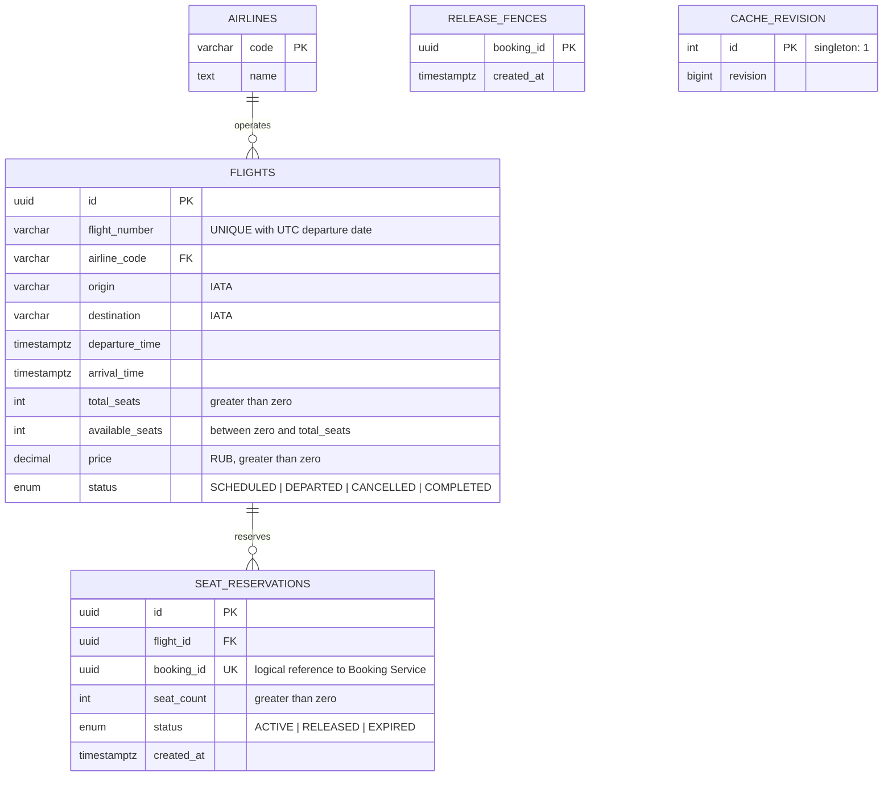
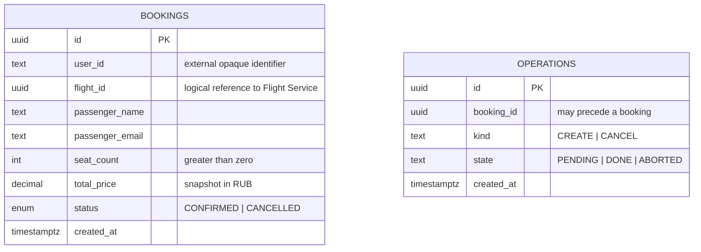

# Схема данных и 3NF

Все таблицы выше принадлежат **Flight PostgreSQL**. Ниже — отдельная **Booking PostgreSQL**:

`Booking.flight_id → Flight.id`, `SeatReservation.booking_id → Booking.id` — логические связи через контракт. Между БД нет внешних ключей, SQL JOIN или доступа одного приложения к БД другого. `operations.booking_id` не имеет FK: запись CREATE обязана пережить сбой ещё до появления бронирования. Успешному бронированию соответствует ровно одна резервация благодаря UNIQUE(booking_id).

Значения атомарны, все неключевые атрибуты зависят от ключа, транзитивные зависимости не дублируются. Название авиакомпании вынесено в `airlines`. Аэропорты представлены только кодами, без зависимых названий и городов. Номер рейса обозначает повторяющийся рейс, но маршрут и авиакомпания могут меняться по датам; конкретный вылет определяется номером и датой UTC. Дата не дублируется отдельной колонкой: уникальность реализована индексом выражения.

`user_id` — идентификатор заказчика, а `passenger_name`/`passenger_email` — данные пассажира конкретной покупки: заказчик может покупать билеты разным людям. Поэтому зависимости `user_id → passenger_name` нет. `total_price` — историческая сумма, текущая цена рейса в Booking не копируется; отдельной вычисляемой колонки `unit_price` нет.

`available_seats` — требуемый заданием счётчик. Его согласованность с суммой ACTIVE-резерваций поддерживается транзакциями; это межтабличный агрегат, а не транзитивная зависимость неключевых полей одной строки. CHECK защищает диапазон, SELECT FOR UPDATE — конкурентные изменения.

EXPIRED предусмотрен контрактом и схемой. Автоматического истечения оплаченных/подтверждённых резерваций нет: отдельный срок действия ТЗ не задаёт.
